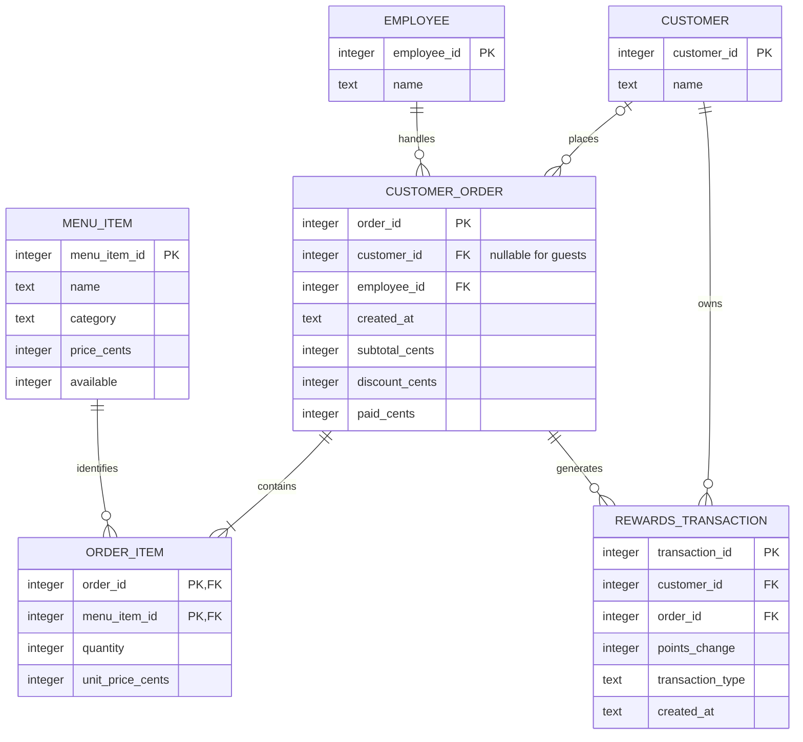

# E-R diagram

## Relational schema notes
`Customer` stores enrolled members; names need not be unique. `Employee` identifies the staff member responsible for a purchase. `MenuItem` stores the current offering. `CustomerOrder` stores one completed purchase and its totals. `OrderItem` resolves the many-to-many relationship between orders and menu items and preserves historical prices. `RewardsTransaction` stores an append-only history through the checkout function; its signed entries determine balances.

`OrderItem` has composite primary key `(order_id, menu_item_id)`. Rewards have a unique `(order_id, transaction_type)` pair and a composite foreign key `(order_id, customer_id)` to the order, preventing rewards being assigned to a different customer. The schema includes the corresponding unique parent key. The one-or-more item cardinality is enforced by the checkout function.
